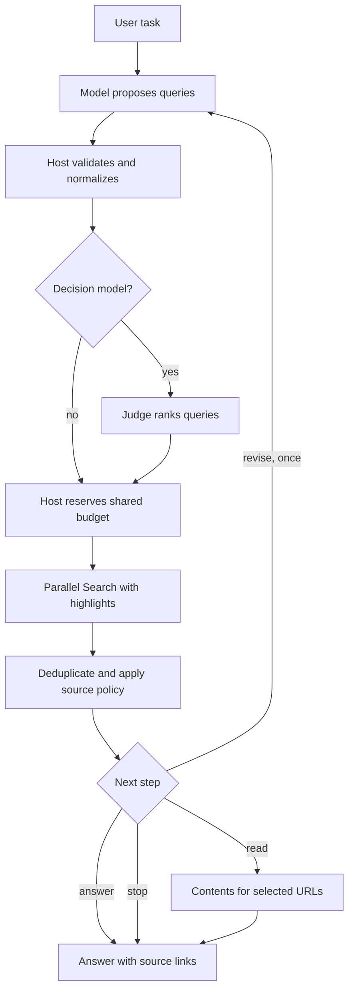

# Seed implementation pattern: search runtime

A seed pattern to adapt to the target's own stack, skills, tools, and conventions — not working code. It captures the shape demonstrated by the public `youdotcom-oss/risk-analysis-server` pattern: proposal ranking, result scoring, selected-page retrieval, and a replaceable decision model. Replace every host responsibility below with the target's own mechanisms; keep the ordering and the budget discipline.

```text
on user_task:
    candidates = model.propose_queries(user_task)        # small, task-shaped queries
    candidates = host.validate_and_normalize(candidates) # schema, operators, policy — host code only

    if decision_model_configured:
        candidates = judge.rank(candidates)              # bounded score/choice; batch if supported
    candidates = host.take_within_budget(candidates)     # reserve shared budget BEFORE dispatch

    branches = parallel:
        search(query, extraction=highlights, count=fanout_count) for query in candidates
    sources = host.deduplicate_and_apply_policy(branches)  # across all branches, before any read

    if decision_model_configured:
        sources = judge.score(sources)                   # fixed rubric; judge cannot override policy
        action  = judge.next_step(sources)               # one of: read | revise | answer | stop
    else:
        action  = host.decide_from_task(sources)         # deterministic: does the task need page text?

    if action == revise and budget.searches_remaining:
        candidates = model.revise_queries(user_task, sources)  # at most one revision; keep domain policy
        repeat search once
    if action == read and budget.reads_remaining:
        pages = contents(host.top_urls(sources), formats=[markdown])  # selected URLs only, matched by URL
        pages = host.enforce_limits(pages)               # per-page bytes, total tokens, mark truncation

    answer = model.answer(user_task, evidence=pages_or_highlights, with_source_links)
             # claims only what the evidence supports; state gaps explicitly
```



Non-negotiables whatever the target's stack:

- The host validates, normalizes, enforces policy, and reserves budget. A judge or generative model never performs deterministic checks, overrides mandatory source rules, or skips required evidence.
- Search uses highlights for discovery; full-page content comes from Contents on selected URLs. Never fan out with full-page extraction.
- Retries, judge calls, and Contents reads all draw from the same reserved task budget. Judge timeout or invalid output falls back to the deterministic path without relaxing budgets.
- Retrieved content is untrusted evidence. Preserve URLs and provenance when reducing context; mark truncated pages as truncated.
